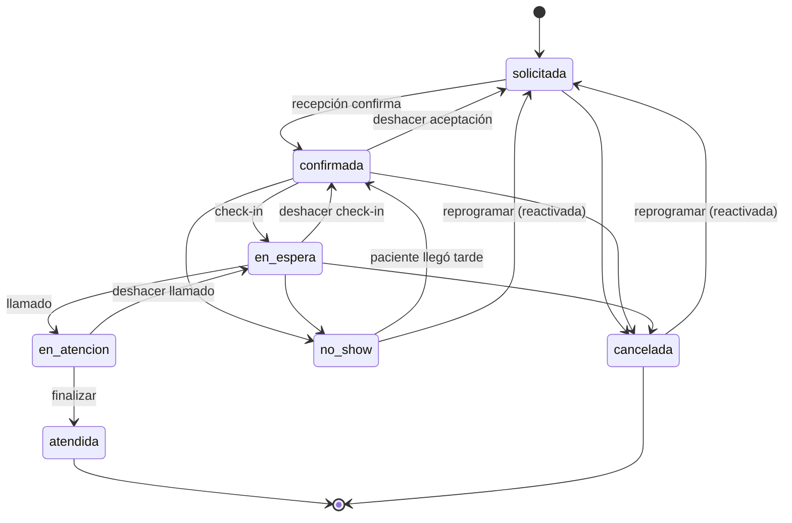
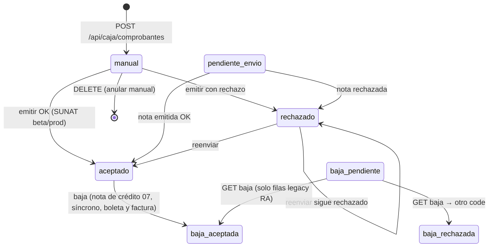
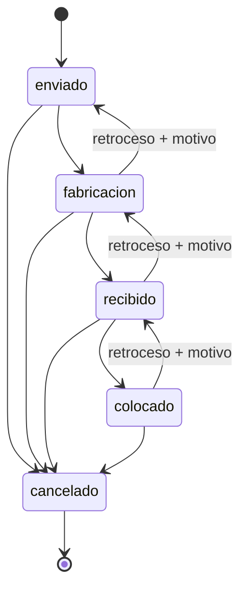
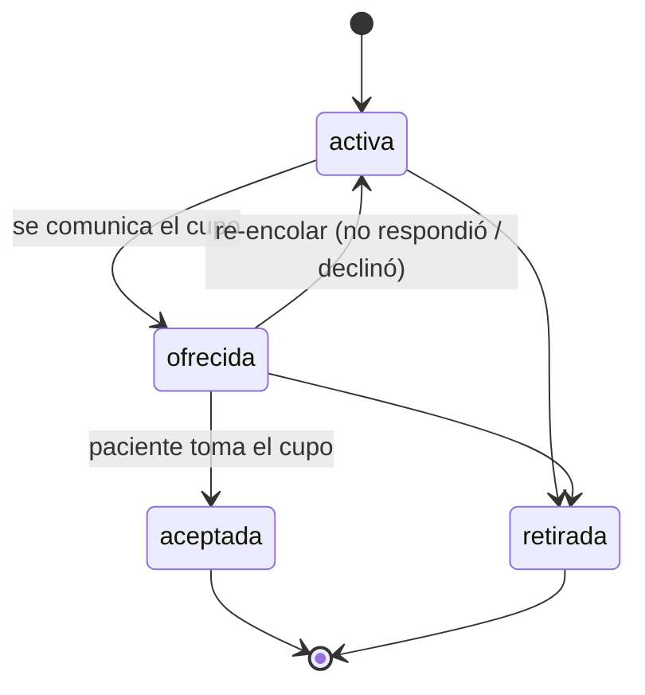
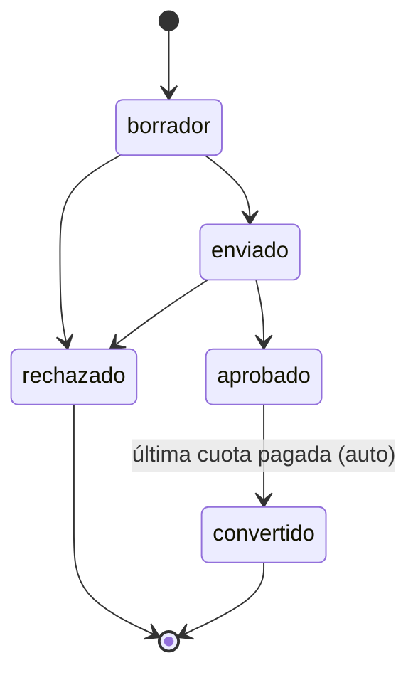
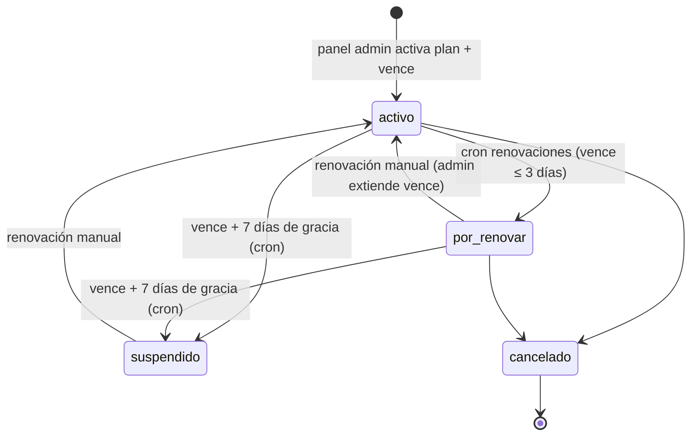

# Estados y protocolos por módulo

Estado a sprint 2026-08-16. Este documento es la referencia única de máquinas de
estado y protocolos de corrección (deshacer/anular/reabrir/retroceder). Cada máquina
está verificada contra el código fuente; si el código y este texto divergen, **el
código manda** y este documento se corrige. Fuentes principales:
`packages/core/src/appointment-state.ts`, `apps/web/src/app/api/**` y
`apps/web/src/lib/{lycet,whatsapp,reminder-engine}.ts`. Los 6 jobs de cron
(`/api/cron/*`) se describen en §10.

Convención de errores: `400` validación, `402 plan_insuficiente` (gating de plan),
`403` permisos, `409` conflicto/transición inválida con `error` en snake_case,
`502/503` integración externa caída (p. ej. `lycet_inaccesible`).

---

## 1. Citas (packages/core/src/appointment-state.ts)

Máquina central del flujo operativo. La tabla `TRANSITIONS` es la verdad absoluta y
se valida server-side con `canTransition`/`assertTransition` en
`POST /api/citas/[id]/estado`.



| Aspecto | Detalle |
|---|---|
| Flujo principal | `solicitada → confirmada → en_espera → en_atencion → atendida` |
| Cancelación | `cancelada` desde `solicitada`, `confirmada`, `en_espera`. Desde `en_atencion` **ya no** se puede cancelar (pasar a `en_espera` y cancelar desde ahí) |
| No-show | `confirmada → no_show` y `en_espera → no_show` |
| Reversibles | `confirmada → solicitada` (deshacer aceptación), `en_espera → confirmada` (deshacer check-in), `en_atencion → en_espera` (deshacer llamado), `no_show → confirmada` (paciente llegó tarde) |
| Terminales | `atendida` y `cancelada`. **`atendida` NUNCA revierte por diseño**: las correcciones post-hoc se hacen anulando el pago (`/api/caja/pagos/[id]/anular`) + un `stock_movements` de `ajuste`/`merma` manual para revertir el inventario. `cancelada` sí se reactiva vía reprogramar |
| Reprogramar | `POST /api/citas/[id]/reprogramar` permitido desde `solicitada`, `confirmada`, `cancelada`, `no_show` (409 `no_se_puede_reprogramar_en_<estado>` en otro estado, p. ej. `en_espera`). Desde estado terminal (`cancelada`/`no_show`) la cita **se reactiva como `solicitada`** y se notifica al paciente por email/WhatsApp (reminder `tipo: "reprogramacion"`). Valida solape (409 `horario_ocupado`) |
| Permisos por estado destino | `en_espera` → `checkin.perform` (recepción/asistente); `en_atencion`/`atendida` → `records.edit` (doctor); resto (`confirmada`, `cancelada`, `no_show`, deshacer) → `appointments.edit`. Regla práctica: el permiso lo pide el estado DESTINO |
| Doctor | Un doctor solo puede cambiar de estado `POST /api/citas/[id]/estado` citas donde `doctorId` = su membership (403 `sin_permiso`) |
| Side effect `atendida` | Al pasar a `atendida` se **consume inventario al momento** (`lib/inventario.ts` `consumirMateriales`, FEFO: lotes ordenados por `vence ASC NULLS LAST`) — ya **no** es fire-and-forget: la respuesta JSON expone `faltantes[]` y la UI de sala de espera muestra "Sin stock de: …" en el toast |
| Error de transición | 409 `no_se_puede_pasar_de_<de>_a_<a>` (snake_case con los estados reales) |

### Sala de espera (consola/sala-espera/avanzar-estado.tsx)

Protocolo de avance seguro: cada botón abre un **Dialog de confirmación previa**
("La cita pasará de X a Y. Podrás deshacerlo unos segundos."). Tras confirmar:

1. `POST /api/citas/[id]/estado`.
2. Si la respuesta trae `faltantes[]` → toast warning con los items sin stock.
3. Si el estado nuevo es reversible (`en_espera → confirmada`,
   `en_atencion → en_espera`, mapa `REVERSIBLES` del componente) → toast success con
   acción **Deshacer** visible **5 s** (duration 5000, dismiss a los 5200).
4. "Deshacer" hace el `POST` inverso y recarga la vista.

Nota: la reversa `no_show → confirmada` y `confirmada → solicitada` existen en la
máquina core pero no llevan toast de deshacer en esta pantalla (se ejecutan por API).

### Drag & drop en agenda día (consola/agenda/vista-dia.tsx)

Solo citas `solicitada`/`confirmada` son arrastrables (nunca en atención, atendidas,
canceladas ni no-show) y solo para roles de consola (doctor no hace drag en "Mi
agenda"). Drop = `POST /api/citas/[id]/reprogramar` con snap de 15 min y cambio de
doctor (columna destino); el 409 `horario_ocupado` muestra toast de error. Reprogramar
una terminal así reactiva como `solicitada` (toast "…(reactivada como solicitada)").

---

## 2. Caja (api/caja/pagos/**, api/caja/cierre/**)

### 2.1 Pagos: valido → anulado

```
payments.estado:  valido ──── anular (motivo ≥3 chars) ────▶ anulado   (nunca hay borrado físico)
```

`POST /api/caja/pagos/[id]/anular` — permiso `payments.register` (owner/recepción) +
plan `caja`. **No hay deshacer de la anulación**: un pago anulado queda así; si fue un
error se registra un pago nuevo con referencia corregida.

Reglas verificadas:

- `motivo` obligatorio, mínimo 3 caracteres → 400 `motivo_requerido`.
- 404 `pago_no_encontrado` si el pago no es del tenant.
- 409 `ya_anulado` si ya está anulado (idempotencia).
- **Bloqueo fiscal**: si el pago tiene comprobante (`receipts.paymentId`) con
  `sunat_estado = aceptado` → 409 `comprobante_sunat_aceptado_primero_dar_baja`.
  Primero debe darse de baja el comprobante (boleta: RA; factura: nota de crédito).
- Efectos encadenados en la misma llamada:
  - `payments` → `estado: anulado`, `anuladoPor`, `anuladoAt`, `motivoAnulacion`
    (el schema reserva además `anulado_con_id` para la futura baja enlazada).
  - `commission_entries` vinculadas → `monto = 0` (se conserva la fila, se pone en 0;
    la respuesta devuelve `comisionesRevertidas` = nº de filas afectadas).
  - `installments` vinculadas → `estado: pendiente`, `pagado: 0`, `paymentId: null`
    (las cuotas quedan exigibles de nuevo).
  - Audit log `pago.anular` con motivo, monto y nº de comisiones revertidas.
- Exclusión de totales: las consultas de caja/diarias filtran `estado = "anulado"`,
  e `ingresosPorMetodo`/sucursales filtran `estado = "valido"` — un anulado no
  aparece en cierre, dashboard, sucursales ni ingresos por método.

### 2.2 Cierre diario: cerrado → reabierto (y nuevo cierre)

```
cash_closures (una fila por intento)
  INSERT (POST /api/caja/cierre) ──▶ estado: cerrado
  POST /api/caja/cierre/[id]/reabrir ──▶ estado: reabierto (solo owner + motivo)
  ──▶ nuevo POST /api/caja/cierre inserta OTRA fila (estado: cerrado)
```

- `POST /api/caja/cierre`: inserta una **fila nueva** por cierre (no upsert). Calcula
  `cierreSistema` con los pagos del día (timezone del tenant) **excluyendo anulados**.
  Si la fila más reciente del día ya tiene `estado = cerrado` → 409 `ya_cerrada`.
- `POST /api/caja/cierre/[id]/reabrir`: **solo owner** (403
  `solo_owner_puede_reabrir`), motivo obligatorio ≥3 chars (400 `motivo_requerido`),
  solo sobre filas con `estado = cerrado` (409 `cierre_no_cerrado`). Escribe
  `reabiertoPor`, `reabiertoAt`, `motivoReapertura` + audit `caja.reapertura`.
- Resolución del "cierre del día": `cierreDelDia` ordena las filas del día por
  `createdAt` desc y toma la **más reciente con `estado = cerrado`** (o la última fila
  si ninguna lo está). Tras reabrir se corrige y se cierra de nuevo → rastro completo
  de intentos, nunca se pisa historia.

---

## 3. Comprobantes fiscales (api/caja/comprobantes/**, lib/lycet.ts)

`receipts.sunat_estado` (enum): `manual | pendiente_envio | aceptado | rechazado |
baja | baja_pendiente | baja_aceptada | baja_rechazada`.



> **Decisión verificada contra SUNAT beta (2026-08-16):** el Resumen de Bajas (RA,
> `/voided/send` con `tipoDoc 03`) es rechazado por SUNAT para boletas (error 2308
> `DocumentTypeCode` inválido) — el RA quedó obsoleto para boletas en beta. La
> **nota de crédito de anulación (tipoDoc 07)** es aceptada tanto para boletas como
> para facturas, con confirmación síncrona. **Toda baja usa nota de crédito.** El
> endpoint `GET /baja` se conserva únicamente para consultar tickets RA legacy
> (`baja_pendiente` ya no se genera).

| Regla | Detalle |
|---|---|
| Emisión | `POST /api/caja/comprobantes/[id]/emitir` solo si `sunat_estado` no es `aceptado/baja/baja_pendiente/baja_aceptada` (409 `comprobante_ya_emitido`). Aceptado = CDR code `"0"` o ≥4000; si falla marca `rechazado` y permite reenvío |
| Manuales | `manual` (y `pendiente_envio` en la UI): editables `serie`/`correlativo` vía `PATCH /api/caja/comprobantes/[id]` y anulables con `DELETE` (borrado físico de la fila manual, audit `comprobante.anular`). **Ojo, verificado en código**: la API solo lo permite con `sunat_estado = manual` (409 `solo_se_pueden_editar_comprobantes_manuales`) |
| Baja (boleta y factura) | `POST .../[id]/baja` sobre `aceptado` (motivo ≥3 chars): crea la fila de nota de crédito (`tipo nota_credito`, `sunat_estado pendiente_envio`, `afectadoId` = comprobante) y la envía a SUNAT `/note/send` con `tipoDoc 07`, `codMotivo 01` (anulación), `tipDocAfectado 01`/`03` según tipo, `numDocfectado = serie-correlativo` real. Aceptación **síncrona**: nota → `aceptado`, original → `baja_aceptada` + `bajaEnviadaAt` + `bajaMotivo`; se persisten XML y CDR en `attachments/fiscal/<tenant>/` |
| Serie de la nota | Derivada del afectado: `B001` → `BN01`, `F001` → `FN01` (primera letra + `N` + últimos 2 dígitos). SUNAT exige serie de **exactamente 4 caracteres** (rechazo `0151` ZIP filename) y la nota debe compartir letra con el afectado (rechazo `2116` si difiere). Correlativo = `MAX(receipts.correlativo)` del tenant para esa serie/tipo + 1 |
| Reintento de baja | Si una nota previa para el mismo comprobante quedó `pendiente_envio` → 409 `baja_en_curso`. Si quedó `rechazada`, se puede reintentar (se crea una nueva nota con el siguiente correlativo) |
| Unicidad por pago | `receipts_payment_unique` es ahora un **índice único parcial** (solo `boleta`/`factura`), lo que permite coexistir la nota de crédito con el comprobante original del mismo pago. `POST /api/caja/comprobantes` valida `pago_ya_con_comprobante` solo para boleta/factura |
| Notas | `receipts.afectadoId` referencia el comprobante afectado real; la UI de comprobantes muestra "anula B001-00000001" en cada nota. `emitir` resuelve `serie-correlativo` del afectado desde la DB y falla con 409 `comprobante_afectado_no_encontrado`/`nota_requiere_comprobante_afectado` |
| Secuencia correcta de corrección | Pago con comprobante aceptado mal cobrado → 1º baja del comprobante (nota de crédito) → 2º `POST /api/caja/pagos/[id]/anular` (el bloqueo fiscal solo mira el comprobante boleta/factura, no la nota) |
| Configuración | `vat_settings` ya no guarda contadores de notas/bajas (`corr_nota`, `corr_baja` eliminados); el correlativo de notas se calcula con MAX por serie. Las series de notas `BN01`/`FN01` se derivan de `serie_boleta`/`serie_factura` |
| Errores de integración | 503 `lycet_no_configurado` (sin `LYCET_URL`), 502 `lycet_inaccesible` (sidecar caído), 409 `rechazado_sunat` con `message` humano, 409 `modo_manual` / `configuracion_incompleta`, 409 `baja_en_curso`, 409 `tipo_no_sujeto_a_baja` (nota de débito/crédito manuales no van por este flujo) |

---

## 4. Laboratorio (api/laboratorio/[id]/estado/route.ts)



- Avance estricto de a un paso: `enviado → fabricacion → recibido → colocado`
  (`colocado` no avanza más); `cancelado` alcanzable desde cualquier estado.
- **Retrocesos permitidos exactamente UN paso** (`fabricacion→enviado`,
  `recibido→fabricacion`, `colocado→recibido`) con `motivo` obligatorio ≥3 chars
  (400 `motivo_requerido_para_retroceder`). En el retroceso se incrementa el contador
  de revisiones `lab_orders.rev` y se guarda `motivoRevision`; en avance normal
  `motivoRevision` vuelve a null. Saltos de más de un paso o hacia atrás del inicio
  → 400 `transicion_invalida`. Desde `cancelado` no se sale.
- Audit: `laboratorio.estado` (avance/cancelación) vs `laboratorio.retroceder`.
- Permiso: `labs.manage` (owner/recepción/asistente/doctor según matriz de `packages/core/src/permissions.ts`).

---

## 5. Lista de espera (api/waitlist/[id]/route.ts)



- Transiciones exactas: `activa → [ofrecida, retirada]`;
  `ofrecida → [aceptada, retirada, activa]`. Cualquier otra → 400 `transicion_invalida`.
- **Re-encolar**: `ofrecida → activa` reintroduce al paciente en la selección por
  `prioridad ASC` para el siguiente hueco (p. ej. no respondió o declinó).
- `DELETE /api/waitlist/[id]` = retirar (equivalente a PATCH `retirada`, solo desde
  `activa`/`ofrecida`).
- El enum incluye `expirada` (legado del diseño original); ninguna ruta actual la
  asigna — el flujo real re-encola (`activa`) o retira.
- Oferta al paciente: `POST /api/waitlist/[id]/notificar` (email con magic link) solo
  sobre `activa`; marcar `ofrecida` es acción de recepción.

---

## 6. Presupuestos y cuotas (api/presupuestos/**, api/cuotas/**)



- `quotes.estado`: `borrador → enviado → aprobado → convertido`;
  `borrador/enviado → rechazado`. 400 `transicion_invalida` en otro caso.
  `rechazado` y `convertido` son terminales (no hay deshacer: se crea un presupuesto nuevo).
- Cuotas (`installments`): se generan con `POST /api/presupuestos/[id]/cuotas`
  (`n` 1..24, solo sobre presupuesto `aprobado`, reparto exacto del total en céntimos).
- `POST /api/cuotas/[id]/pagar`: exige `paymentId` de un pago del mismo paciente
  (400 `pago_paciente_no_coincide`); rechaza si ya está `pagada`/`cancelada`
  (400); marca `pagada`, `pagado = monto`, `paymentId = pago`.
- `PATCH /api/cuotas/[id]/pagar`: única mutación permitida es `estado: cancelada`
  (400 `transicion_invalida` si está pagada o ya cancelada) — para reestructurar el plan.
- **Cierre automático**: al pagarse una cuota, si todas las hermanas del mismo
  `quoteId` quedan `pagadas`, el presupuesto `aprobado` pasa a `convertido`
  automáticamente (respuesta `presupuestoConvertido: true`).
- Al aprobar (`aprobado`) se envía email al paciente con el detalle y link de reserva
  (si tiene email y el correo está configurado).
- Estado del enum `installment_status` no asignado por la API actual: `parcial`
  (los pagos se registran por cuota completa). `vencida` sí se asigna: el cron
  `seguimiento` marca `vencida` cada cuota `pendiente` cuyo `vence` ya pasó
  (timezone America/Lima).

---

## 7. Notificaciones (lib/whatsapp.ts, lib/reminder-engine.ts, api/whatsapp/webhook)

Tipos de reminder (`ReminderTipo`): `recordatorio_24h`, `confirmacion_solicitud`,
`recall`, `reprogramacion`.

- **Proactivos por plantilla**: `recordatorio_24h` y `recall` salen fuera de la
  ventana de 24 h del paciente, así que usan plantillas aprobadas de Meta
  (`type: "template"`, `language.code` y `parameters` posicionales de texto vía
  `enviarPlantillaWhatsApp`). El texto libre (`type: "text"`) fuera de ventana falla
  con error Meta de la familia `CODIGOS_FUERA_ALCANCE` (incluye **131047**, 131031,
  130472, etc.). `confirmacion_solicitud` y `reprogramacion` se envían como texto.
- **Fallback automático a email**: si WhatsApp no está configurado, el envío de
  plantilla falla o el celular es inválido, `enviarRecordatorio` reintenta por email
  (Resend) y registra el `reminder` final con el canal realmente usado
  (`canal: whatsapp|email`) y el error si ambos fallan. Sin email de destino ni
  celular válido → reminder `error: paciente_sin_email`.
- Plantilla configurable por tenant: `notification_settings.plantilla_recordatorio`
  (default `recordatorio_cita`) + `idioma_plantilla` (default `es`); el cron 24h pasa
  4 parámetros posicionales (nombre, fecha larga es-PE, hora, clínica).
- **Webhook Meta**: `GET /api/whatsapp/webhook` valida `hub.mode=subscribe` +
  `hub.verify_token` (env `WHATSAPP_VERIFY_TOKEN`, default `odontoflow-verify`) y
  responde el `hub.challenge`; al verificar escribe
  `whatsapp_settings.webhook_verified_at` (nota: el UPDATE actual toca todas las
  filas con `activo = true`). `POST` registra mensajes entrantes por audit
  (`whatsapp.mensaje_entrante`, texto truncado a 40 chars) y siempre responde 200
  para que Meta no reintente.
- Cron `POST /api/cron/recordatorios` (Bearer `CRON_SECRET`): recorre tenants con
  recordatorio 24h activo; es **idempotente** por cita (si ya existe un reminder
  `recordatorio_24h` para esa cita la omite). El reenvío manual de recordatorios
  fallidos se hace vía `POST /api/recall` con `tipo: "recall" | "recordatorio_24h"`
  (retry desde consola, permiso `reminders.send`).

---

## 8. Protocolo de deshacer/corrección (principios)

Principio general: **toda corrección deja rastro** (audit + motivo cuando aplica);
nada se borra físicamente salvo los comprobantes manuales no enviados. Los errores de
estado siempre devuelven 409 con `error` clave snake_case y la UI lo muestra en toast.

| Entidad | Quién puede deshacer | Ventana | Mecanismo | Efectos secundarios revertidos |
|---|---|---|---|---|
| Cita `en_espera`/`en_atencion` | Staff con el permiso del estado destino (`appointments.edit` / `checkin.perform`) | 5 s (toast "Deshacer" en sala de espera) o manual vía API después | `POST /api/citas/[id]/estado` al estado anterior | Ninguno pendiente: el inventario solo se consume en `atendida` |
| Cita `atendida` | Nadie (terminal por diseño) | — | Corrección post-hoc = anular pago + movimiento `ajuste`/`merma` de inventario | Inventario vía kardex manual; comisiones/cuotas vía anulación del pago |
| Cita `cancelada`/`no_show` | `appointments.edit` | Sin límite | `POST /api/citas/[id]/reprogramar` → reactiva como `solicitada` | Notificación al paciente (plantilla `reprogramacion`, email/WhatsApp) |
| Pago | `payments.register` (owner/recepción) | Sin límite; si hay comprobante `aceptado`, primero su baja | `POST /api/caja/pagos/[id]/anular` (motivo ≥3) | Comisiones → monto 0; cuotas → pendiente (pagado 0, paymentId null); exclusión de todos los totales |
| Cierre diario | **Solo owner** | Mientras no exista un cierre más reciente `cerrado` | `POST /api/caja/cierre/[id]/reabrir` (motivo) + nuevo `POST /api/caja/cierre` | El cierre nuevo reemplaza la cifra del día; la fila reabierta queda como rastro |
| Comprobante manual | `receipts.issue` (owner/recepción) | Mientras `sunat_estado = manual` | `PATCH` (serie/correlativo) o `DELETE` (anulación física + audit) | Ninguno (no se envió a SUNAT ni afectó totales propios) |
| Comprobante aceptado | `receipts.issue` | Hasta que SUNAT acepte la baja | Boleta: RA asíncrona (`POST`/`GET .../baja`); factura: nota de crédito 07/01 síncrona | Ninguno fiscal adicional; habilita la anulación contable del pago |
| Pedido de laboratorio | `labs.manage` | Retroceso de UN paso | `PATCH /api/laboratorio/[id]/estado` (motivo ≥3) | `rev + 1`, `motivoRevision`; sin efectos dinerarios |
| Waitlist | `waitlist.manage` | Mientras `ofrecida` | PATCH `activa` (re-encolar) o `retirada` | La selección vuelve a considerar al paciente por prioridad |
| Cuota | `quotes.manage` | Antes de `pagada` | `PATCH /api/cuotas/[id]/pagar` → `cancelada` | La anulación del pago vinculado la devuelve a `pendiente` |
| Presupuesto | — | — | Sin deshacer: `rechazado`/`convertido` terminales; se crea uno nuevo | — |

### Errores estándar (catálogo verificado)

| HTTP | Clave | Cuándo |
|---|---|---|
| 400 | `json_invalido`, `motivo_requerido`, `estado_invalido`, `transicion_invalida`, `motivo_requerido_para_retroceder`, `cuota_ya_pagada`, `cuota_cancelada`, `n_invalido`, `pago_paciente_no_coincide`… | Validación de entrada / estados no permitidos por la máquina |
| 402 | `plan_insuficiente` (+ `requerido`, `plan_actual`) | Gating server-side (`gatePlan`); la UI ofrece renovación por Yape |
| 403 | `solo_owner_puede_reabrir`, `sin_permiso` | RBAC |
| 409 | `no_se_puede_pasar_de_<de>_a_<a>`, `transicion_invalida` (citas usa la forma larga), `ya_anulado`, `comprobante_sunat_aceptado_primero_dar_baja`, `ya_cerrada`, `cierre_no_cerrado`, `solo_se_puede_dar_de_baja_un_comprobante_aceptado`, `solo_se_pueden_editar_comprobantes_manuales`, `comprobante_ya_emitido`, `rechazado_sunat`, `correlativo_ocupado`, `horario_ocupado`, `modo_manual`, `configuracion_incompleta`, `tipo_no_sujeto_a_baja` | Conflicto de estado/transición/recurso |
| 502/503 | `lycet_inaccesible`, `lycet_no_configurado`, `consulta_fallida`, `email_no_configurado` (400) | Integración externa (sidecar Greenter, Resend) caída o sin credenciales |

---

## 9. Suscripción del tenant (cron/renovaciones)

Ciclo del plan de pago (manual, Yape/Plin vía panel admin). Máquina en tabla
`subscriptions`:



- Cron `renovaciones` (cada hora, contenedor cron): marca `por_renovar` cuando
  `vence` está a ≤3 días; envía aviso de vencimiento al owner el día exacto
  (`suscripcion.vencida`, dedupe 24h por audit); tras 7 días de gracia pasa a
  `suspendido` (`suscripcion.suspender_auto` + aviso). Cada paso deja audit.
- `suspendido`/`cancelado` degradan a plan free en `gatePlan` (402
  `plan_insuficiente`); renovar desde el panel admin reactiva al instante.
- El aviso de vencimiento requiere Resend configurado; sin email, la transición
  igualmente se ejecuta y queda audit.

## 10. Crons (apps/web/src/app/api/cron/*)

Los 6 endpoints aceptan solo `POST` con `Authorization: Bearer $CRON_SECRET`
(`CRON_SECRET` env; sin header válido → 401 `no_autorizado`). En producción los
ejecuta el contenedor `cron` (supercronic, `CRON_TZ=America/Lima`) del
`docker-compose.prod.yml`; en desarrollo local Windows, `scripts/instalar-cron.ps1`
(dev-only).

| Job | Frecuencia | Comportamiento clave |
|---|---|---|
| `recordatorios` | Cada hora | Recordatorio 24h a citas `confirmada` de mañana (en la timezone del tenant); idempotente por cita (`recordatorio_24h` ya existente → omite). En segunda pasada reintenta reminders en `error` de las últimas 48h |
| `renovaciones` | Cada hora | Ciclo de suscripción de §9; respuesta `{marcadas, sinVencimiento, avisosVencimiento, suspendidas}` |
| `fiscal` | Cada hora | Reemite `pendiente_envio` (≤7d) y `rechazados` (≤48h); respuesta `{candidatos, reemitidos, rechazados, errores}` |
| `diario` | Diario 08:00 Lima | Digest al owner (caja, stock bajo, laboratorio, pendientes); sin Resend omite y responde `omitido: email_no_configurado` |
| `recall` | Diario | Recall automático solo en tenants con `recallAuto` ON; pacientes dormidos ≥6 meses (o sin visitas desde su alta); dedupe 60 días por reminder previo |
| `seguimiento` | Diario | Presupuestos `enviado`: 1er aviso a los ≥3 días (`seguimiento1At`), final a los ≥7 (`seguimiento2At`), cada uno una sola vez; además marca `vencida` las cuotas cuyo `vence` pasó (America/Lima) |
